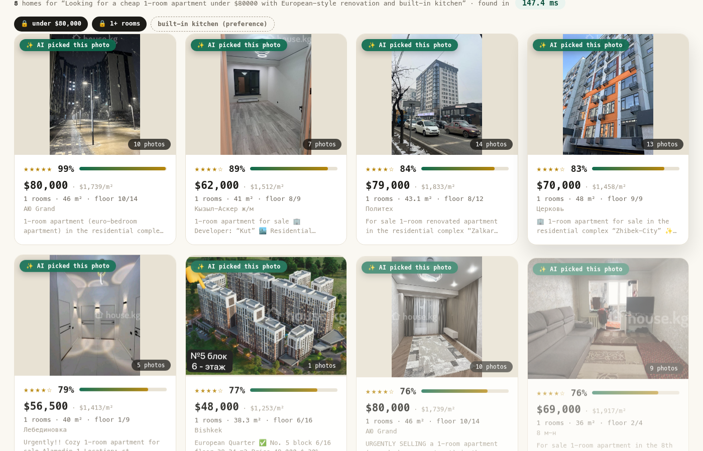
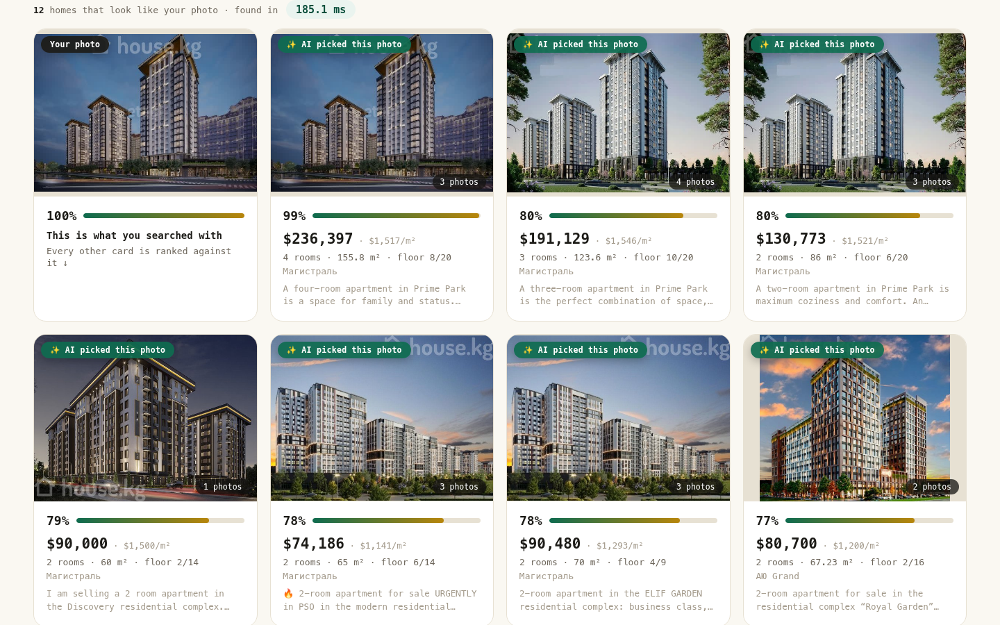
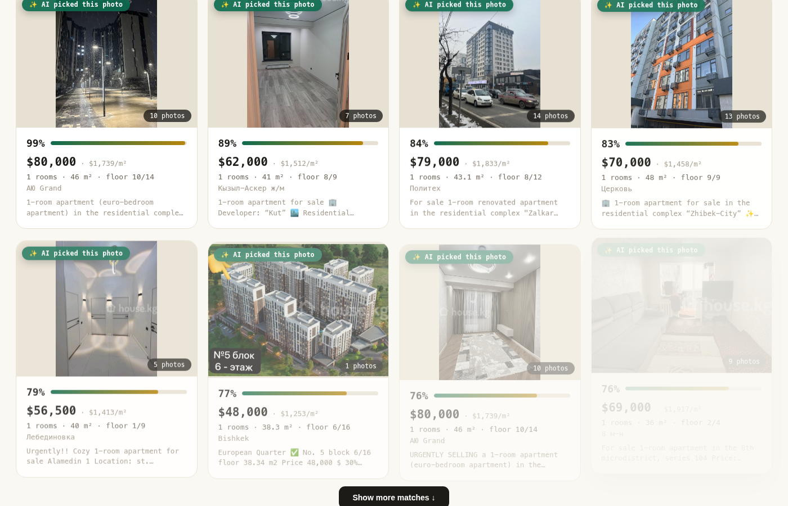

# Real-Estate Vector Search — photo-aware, meaning-aware listing search

Type one sentence, get homes — ranked by **meaning**, matched down to the
**exact photo**, with budgets that actually hold (`under $100k` means
under $100k). Or **drop a photo** and find listings that look like it.

Built and run end to end on real data: **7,300+ apartments, 60,000 photos,
millisecond answers on a second-hand RX 5700 XT**. One solo developer,
one cheap GPU, zero paid AI services.

| AI sentence search | Search by photo |
|---|---|
|  |  |

Every result card shows the photo the engine actually matched — not the
cover shot — with a score. On the property page, matched photos carry
percentage ribbons: per-photo attribution, not black-box vibes.

| Property page |
|---|
|  |

## Architecture (30 seconds)

```text
                    ┌──────────── offline, once ────────────┐
  CSV + 60k photos →  prep → translate (RU→EN, cached) → embed
                     dHash dedupe   manifest.jsonl        │ (llama.cpp, Vulkan GPU)
                                                          ▼
                                              pgvector: listings + chunks
                                              (text · per-image · joint prop)
                                              256-dim MRL, HNSW m=16 ef=64
                    ┌──────────── per query ────────────────┐
  sentence ────────▶ deterministic constraint parser
                     "under $100k, 2 rooms" → SQL pre-filter
   photo (bytes) ───▶ 960px resize → image embedding
                     SQL survivors → vector rank ×3 kinds
                     → RRF fusion → winning photo cited + scored
```

One-command demo:

```bash
sudo ./run.sh        # Postgres + GPU embed server if needed, then the site
# → http://127.0.0.1:8002   (first search warms up, then ~150 ms)
```

## What's inside

- **AI search** (`/api/aisearch`): deterministic constraints (price/rooms/area)
  become SQL pre-filters → `EmbeddingGemma-2` vectors rank inside → **RRF
  fusion** across text/photo/joint signals → shortfalls backfill as *labeled*
  near-misses ("$130,000 — $10,000 over budget"). Never empty, never lying.
- **Search by photo** (`/api/imagesearch`): raw bytes in → 960px resize →
  image embedding with the media marker → exact scan across all three vector
  kinds → pool-normalized match %. Verified: feed a listing its own photo and
  it comes back top at ~99% in ~185 ms warm.
- **Property pages** (`/property/<id>`): gallery + lightbox, specs table,
  price/m², mortgage estimate, amenities, similar homes (nearest *joint*
  property vectors, not price-band neighbors).
- **Classic filters** underneath: RESO-style ListPrice, BedroomsTotal,
  LivingArea, YearBuilt, City — AI ranking on top.

## Retrieval design decisions worth stealing

- **Numbers first, vibes second.** "Under $100k" is parsed deterministically
  and enforced as SQL before any ranking — semantic similarity between
  in-range and out-of-range listings differs by ~0.02, so vectors alone will
  happily lie about budgets.
- **Strict-first with labeled backfill.** When nothing fits every rule,
  near-misses return clearly labeled ("over budget by $10k") instead of
  quietly breaking the user's constraint or returning an empty page.
- **Per-photo + joint vectors, not one vector per listing.** A single
  property-level vector dilutes sparse photo signals (a pool in 1 of 40
  photos) and loses photo attribution. Joint vectors carry the gestalt;
  per-photo vectors carry recall and citation. RRF fuses both.
- **Bilingual/multilingual for free.** EmbeddingGemma-2 is multilingual;
  documents are translated once (RU→EN, cached + resumable) and search works
  in either language.
- **dHash near-dupe removal** (`hamming ≤ 5`) + blank-tile removal at prep
  time; 567 junk images dropped without quality loss.

## Llama.cpp embedding-server integration notes

Hard-won details that will save you days (see `embed-server.sh`):

- the multimodal media marker is **random per server start** — read it from
  `GET /props`
- task prefixes are REQUIRED or cross-modal ranking silently flips:
  `task: search result | query: ...` vs `title: ... | text: ...`
- multimodal responses nest as `[{"index": ..., "embedding": [[...]]}]`
- multimodal forward passes must fit ONE ubatch — batch the server with
  `-ub 8192`, not the default 1024 (joint under-load calls → HTTP 500
  otherwise)
- server returns 768-dim for this model; 256-dim **MRL truncation happens
  client-side + renormalize**

## Pipeline

```bash
python real-estate-to-vec.py --step all --dataset bishkek
# stages run separately: download translate prep embed load verify
# embed needs ./embed-server.sh up (GPU, ~0.1–0.3 s/image → ~60k images in
# hours; the same job is ~23 s/image on CPU → weeks)
```

- `download`: HuggingFace dataset CSV + per-listing image trees (resumable)
- `translate`: free Google endpoint, cached + resumable JSON
- `prep`: ALL images per listing in gallery order, 960px long side, dHash
  dedupe, EN docs, `manifest.jsonl`
- `embed`: 1 text + N image + 1 joint property vector per listing, 256-dim
  MRL (server returns 768 → client truncates + renormalizes); chunks beyond
  the context budget get text + image vectors only (no degraded joint
  fallback, by design)
- `load`: `listings` + `chunks(kind='listing'|'image'|'property')`,
  `vector(256)`, HNSW index
- `verify`: fused mini-eval (RRF k=60), hit@1/hit@3 report

## Repo layout

| Path | What |
|---|---|
| `real-estate-to-vec.py` | full pipeline: download → translate → prep → embed → load → verify |
| `site.py` + `site-static/` | demo website (FastAPI + vanilla JS frontend) |
| `embed-server.sh` | GPU embedding server launcher (:8081, llama.cpp Vulkan) |
| `run.sh` | one-command demo launcher (env-driven, sanitized) |
| `docs/` | screenshots |

## Requirements

Linux + Python 3.12+ venv (`sentence-transformers`, `torch`, `psycopg`,
`pandas`, `pillow`, `huggingface_hub`), Postgres 14+ with `pgvector` +
`unaccent`, llama.cpp built with Vulkan or CUDA. **GPU optional** — CPU
fallback via `--backend st` works, but is painfully slow at image scale.

## Dataset note

The demo dataset is Bishkek apartments: `raimbekovm/bishkek-real-estate`
(CC-BY-4.0). Photos belong to their owners. The code is dataset-agnostic —
it takes many numeric/text columns (`Price $…, N rooms, …` docs) and any
image folder tree; a Flanders (Belgium) pipeline lives in the same script
via `--dataset flanders`.

## License

Code: MIT. See [`LICENSE`](LICENSE).
